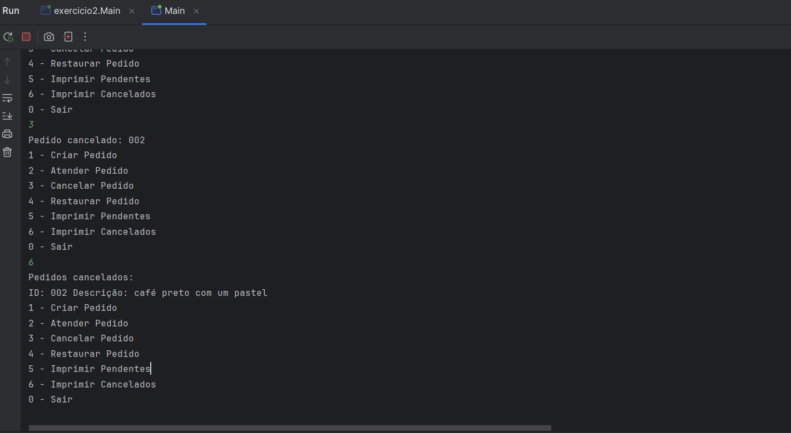
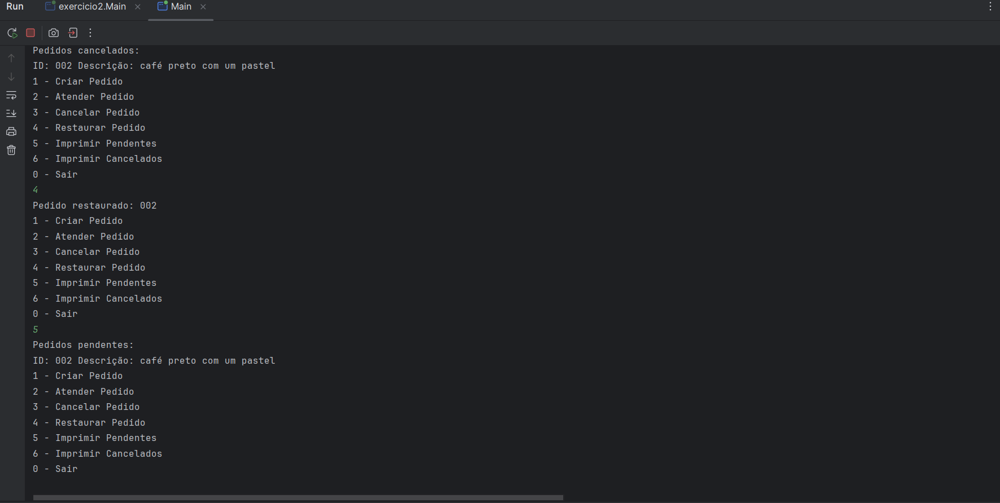
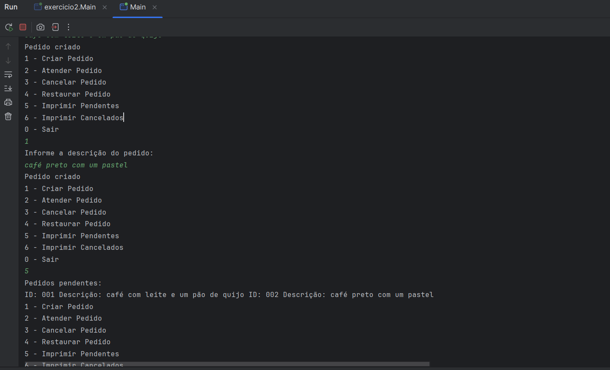
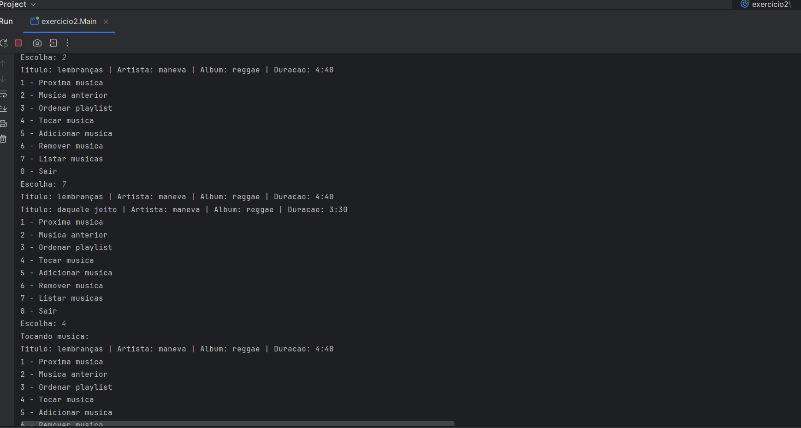
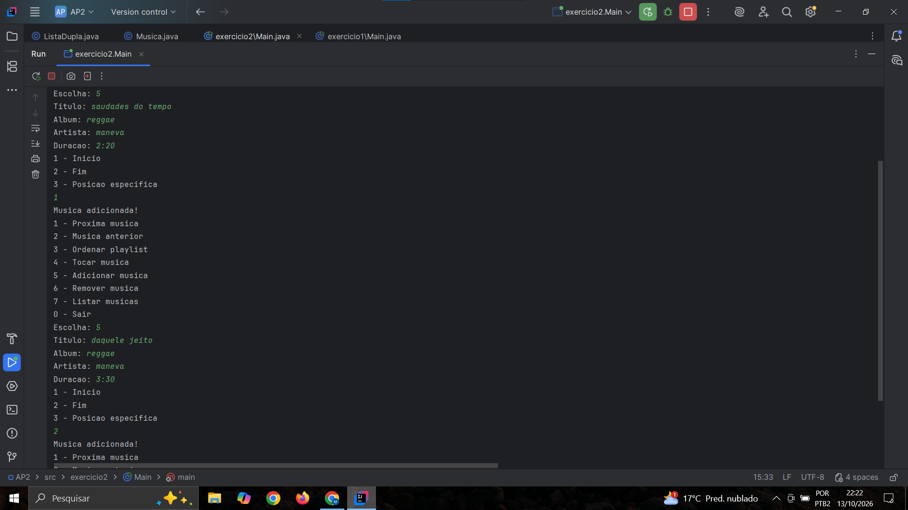
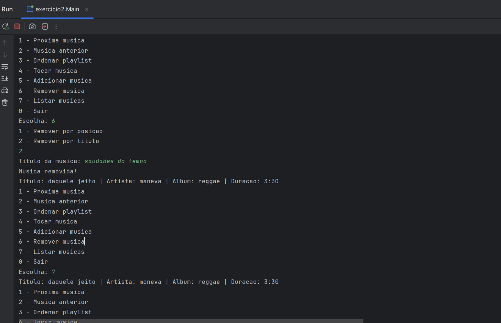

# Relatório Técnico — AP2: Estruturas de Dados

## Identificação

**Aluno:** Micael Alves Evaldt  
**Curso:** Análise e Desenvolvimento de Sistemas  
**Instituição:** ULBRA — Campus Torres  
**Professor:** Juliano Ramos Matos

## Introdução

Implementar estruturas de dados manualmente ajuda a entender como os elementos são organizados na memória. Neste trabalho, pratiquei o uso de nós e ponteiros para conectar os elementos, realizando operações sem depender de estruturas prontas do Java. Isso permitiu compreender melhor o funcionamento das inserções, remoções e atualizações das referências entre os elementos.

## Implementação

### Exercício 1 — Pedidos da cafeteria

Implementei uma fila para armazenar os pedidos pendentes e uma pilha para guardar os pedidos cancelados.

Cada nó armazena um elemento e uma referência para o próximo nó. A fila segue o princípio FIFO, em que o primeiro pedido inserido é o primeiro a sair. A pilha segue o princípio LIFO, em que o último pedido cancelado é o primeiro a ser restaurado.

O programa permite criar, atender, cancelar e restaurar pedidos, além de exibir os pedidos pendentes e cancelados.

### Exercício 2 — Playlist de músicas

Implementei uma lista duplamente ligada para organizar uma playlist. Cada nó armazena uma música e possui duas referências: uma para o próximo nó e outra para o anterior.

Cada música contém título, artista, álbum e duração. O programa permite adicionar músicas no início, no fim ou em uma posição específica, remover por posição ou título, navegar entre as músicas, tocar a música atual, ordenar por título ou artista e exibir a playlist.

### Casos críticos

Durante a implementação, considerei algumas situações importantes:

- **Remoção em estrutura vazia:** verificar se existem elementos antes de realizar a remoção.
- **Atualização dos ponteiros:** ajustar as referências dos nós após inserções e remoções.
- **Início e fim:** atualizar essas referências quando o primeiro ou o último elemento é removido.
- **Lista com um único elemento:** garantir que o início e o fim sejam atualizados corretamente.
- **Música não encontrada:** verificar se o título existe antes de removê-la.

Esses cuidados ajudam a evitar erros e manter as estruturas funcionando corretamente.

## Evidências de Execução

As capturas de tela mostram a execução dos exercícios e as principais operações realizadas.

### Exercício 1 — Pedidos da cafeteria

**Pedidos cancelados**

**Exibição dos pedidos**

**Pedidos pendentes**

### Exercício 2 — Playlist de músicas

**Exibição da playlist**

**Inserção de músicas**

**Remoção de música**

## Conclusão

A maior dificuldade que encontrei neste trabalho foi aplicar a lógica das estruturas de dados e entender como os elementos se conectam. Tive dificuldade em compreender quando um elemento passa para o final da fila, quando um nó precisa apontar para outro e como as referências devem ser atualizadas durante as inserções e remoções. Com a prática e os testes realizados, fui entendendo melhor como essas operações funcionam. Com este trabalho, aprendi mais sobre pilhas, filas e listas ligadas, além de desenvolver minha lógica de programação em Java.
